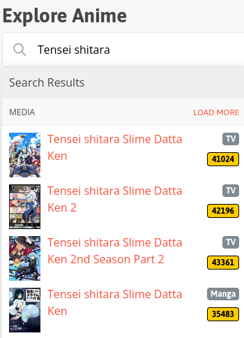

**If you like my work feel free to support me on:** 

# Kitsu ID Grabber

---

## Description

This userscript adds copy buttons for Kitsu IDs to **[kitsu.app](https://kitsu.app)**.
Kitsu does not show the ID of an anime or manga anywhere, so this script makes it available with a single click.
It works in the search results as well as on the detail page of an anime or manga.

---

## Features
- Copy button with the ID below the media type label of every search result
- Copy button in the navigation bar on every anime and manga detail page
- Clicking a button in the search results copies the ID without opening the page
- The button briefly turns green after copying
- Works for every media type