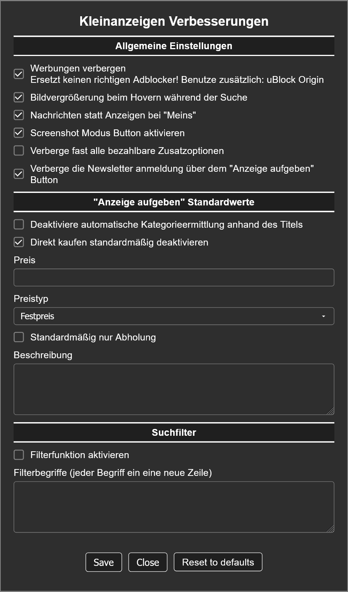
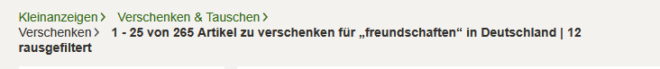
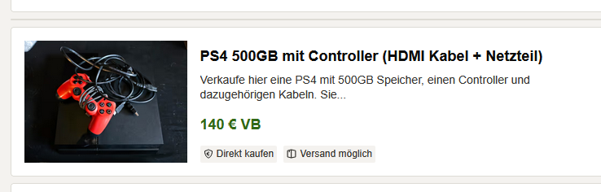
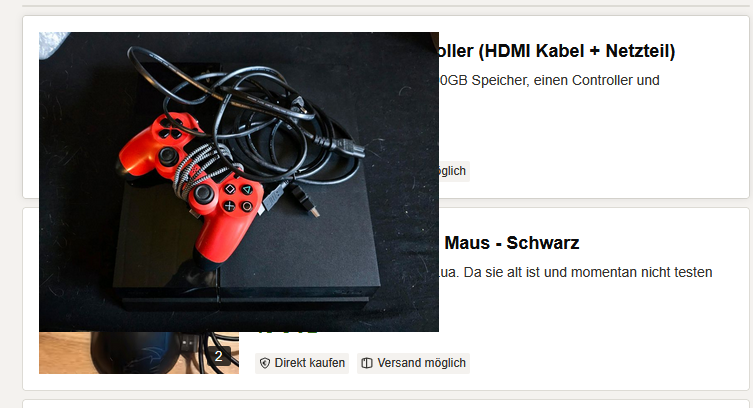

**If you like my work feel free to support me on:** 

# Kleinanzeigen Verbesserungen

> This is a userscript for the German website **[kleinanzeigen.de](https://www.kleinanzeigen.de)**, therefore the following text is written in German.

---

## Funktionen

Dieses Script erweitert **kleinanzeigen.de** um nützliche Features und Verbesserungen, die sich direkt über ein Einstellungsmenü ein- und ausschalten lassen.

- **Werbung ausblenden** (ersetzt keinen richtigen Werbeblocker)
- **Bildvorschau bei Maus-Hover vergrößern**
- **„Meins“-Menü zur Nachrichtenübersicht umleiten**
- **Screenshot-Modus in der Nachrichtenansicht**
- **Bezahlbare Zusatzoptionen verbergen**
- **Newsletter-Checkbox automatisch verbergen**
- **KI-Elemente ausblenden** (Inserieren und Artikelseiten)
- **PRO-Angebote in der Suche ausblenden**

---

## Anzeige aufgeben: Standardwerte

In der „Anzeige aufgeben“-Maske lassen sich über das Script bestimmte Felder vorausfüllen oder deaktivieren:

- KI-Vorschlagsbanner („Mach deine Anzeige schnell mit KI“) wird ausgeblendet, sobald ein Standardwert gesetzt ist
- „Direkt kaufen“-Option standardmäßig ausschalten
- Standardwerte für: Preis, Preistyp, Beschreibung und Abholung

Empfehlenswert, wenn vieles auf einmal eingestellt wird und man ständig alles neu ausfüllen muss.

---

## Suchfilter

Mit der integrierten Filterfunktion kannst du unerwünschte Anzeigen auf Basis bestimmter Wörter im Titel automatisch ausblenden.

- Begriffe werden zeilenweise angegeben
- Die Groß- und Kleinschreibung der Begriffe ist egal (case-insensitive Filterung)
- Gefilterte Einträge werden sofort aus der Liste entfernt
- Die Anzahl der entfernten Einträge wird oben in der Übersicht angezeigt

Ideal, um direkt die Leute auszublenden, die die „Zu verschenken“-Kategorie missbrauchen, um WhatsApp-Gruppen zu promoten oder verzweifelt nach „Freundschaften“ zu suchen. 
ᴵᶜʰ ʰᵃˢˢᵉ ᵈᶦᵉˢᵉ ˡᵉᵘᵗᵉ ˢᵒ ˢᵉʰʳ

### PRO-Angebote ausblenden

- Entfernt alle Anzeigen mit PRO-Abzeichen aus der Ergebnisliste
- Funktioniert unabhängig vom Wortfilter, beide lassen sich einzeln oder zusammen nutzen
- Die Anzahl der entfernten Einträge wird ebenfalls oben in der Übersicht angezeigt

---

## Künstliche Intelligenz

Alle KI-Elemente von Kleinanzeigen lassen sich einzeln ausblenden, standardmäßig sind sie sichtbar:

- **Inserieren:** Der KI-Banner „Mach deine Anzeige schnell mit KI“ wird ausgeblendet
- **Artikelseiten:** Die KI-Zusammenfassung, die KI-Fragebox mit den Vorschlägen und der schwebende KI-Chat-Button werden ausgeblendet

> **Achtung:** Kleinanzeigen hat bei den KI-Tools automatisch die „KI-Analyse von deinen Nachrichten“ aktiviert. Es wird empfohlen, diese in den [Kleinanzeigen Einstellungen](https://www.kleinanzeigen.de/m-einstellungen.html) auszuschalten. Das Script weist im eigenen Einstellungsmenü ebenfalls darauf hin.

---

## Bildvorschau

